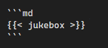

+++
date = '2026-10-16T21:30:00+08:00'
draft = false
title = '音乐播放器与唱片机页开发记录'
categories = ["others"]
summary = "现在体验到vibe coding有多离谱了"
+++

在codex的帮助下，搞了一个梦寐以求的放歌模块，终于可以爽听歌敲文章了（）下面记录一下开发过程。

## 歌曲来源

搜到的方案是APlayer + Meting（甚至有和我一样blowfish搞的），读取wyy歌单id就可以，除此之外还有很多方案，不过分析一下有的要php主机，有的容易挂，有的还得存我登录cookie，有的要跑workflow，最后在和codex探讨下选择了：**网易云的官方外链端点**。。

```
https://music.163.com/song/media/outer/url?id=<sid>.mp3
```

这个地址是永久有效的重定向端点，点开它自己会跳到真正的音频，可以实现真正**纯前端**放歌。代价是它**只有部分免费歌128kbps**，vip放不了，有的免费歌要登录，在data/music.yaml中输入如下格式的歌单即可放歌


```yaml
tracks:
  - id: 2661494556
    name: WonderStruck
    artist: PHONO RECORDS / Shiroi-Ice / Ceru_
    cover: http://p2.music.126.net/y0a53SxrzPB2vp50HdVkaA==/109951170331265990.jpg?param=130y130
```

放不了的歌也设置了一个自动跳过，被我注释在歌单里了，等有心人来欣赏（

## 播放器ui

播放器本体用的是下面这个，本地部署：



激情vibe一会大概vibe出了这些东西：

```
assets/lib/aplayer/          # APlayer 本体
assets/js/music-player.js    # 初始化、深色联动、出错跳过、切页续播
assets/css/music-player.css  # 悬浮卡片外观
data/music.yaml              # 歌单
layouts/partials/extend-*.html
```

## 如何跳转不断音

搜到的方式是pjax，codex说有几个坑：

```
- **选择器太贪心。** 我一开始让 PJAX 替换 `header`，看着很合理。但首页正文里的卡片也用了 `<header>` 标签，新旧页面一对比，数量是 4 对 2，PJAX 认为"结构不一样"直接放弃，静悄悄退回整页跳转——功能等于没做。改成 `body > header` 才通。

- **主题的 JS 不是一整个包。** 我以为重放 `main.bundle` 就够了，结果那是拼接出来的小包，深浅色切换脚本根本不在里面。于是翻页之后：音乐还在放，但主题切换按钮按了没反应。

- **不能重复执行。** 想让那些脚本对新页面重新生效，最直接的想法是"再执行一遍"。但 Blowfish 的脚本是拼接出来的，`const` 声明都露在最外层，第二次执行直接报"标识符已声明"。最后是把它包进一个函数作用域里执行——声明落进局部，就能重复跑。

- 再加上一个隐藏问题：这些脚本会往 `window`/`document` 上挂监听器，每翻一页挂一批，翻几十页就积一堆。所以现在每次重放前会先卸掉上一批。
```

最后的机制是这样：PJAX只替换`title`、头部和正文；**页脚不换**，所以播放器脚本不会被重复执行；而播放器面板挂在`body`上、`<audio>`元素不在DOM，所以翻页可以做到不断音。顺便留了两个调试用的东西：控制台里`window.__kaMusicPlayer`是播放器实例，`window.__navPjaxStats` 记录了跳页次数、重放了几次脚本、第几次出错。

## 唱片机页面

最后仿照圆神的博客，搞了个抽奖的东西，可以抽首歌直接开听，设计成短码，本身只作为一个跳板，用来控制播放器切歌。短码测试如下：



## 集成到config

最后把这个玩意的开关扔到了`params.toml`里。

## 后记

感谢ds，前两天刚蹬四十多块钱给我现在返回来了，我现在敢在梁文峰时期vibe coding（