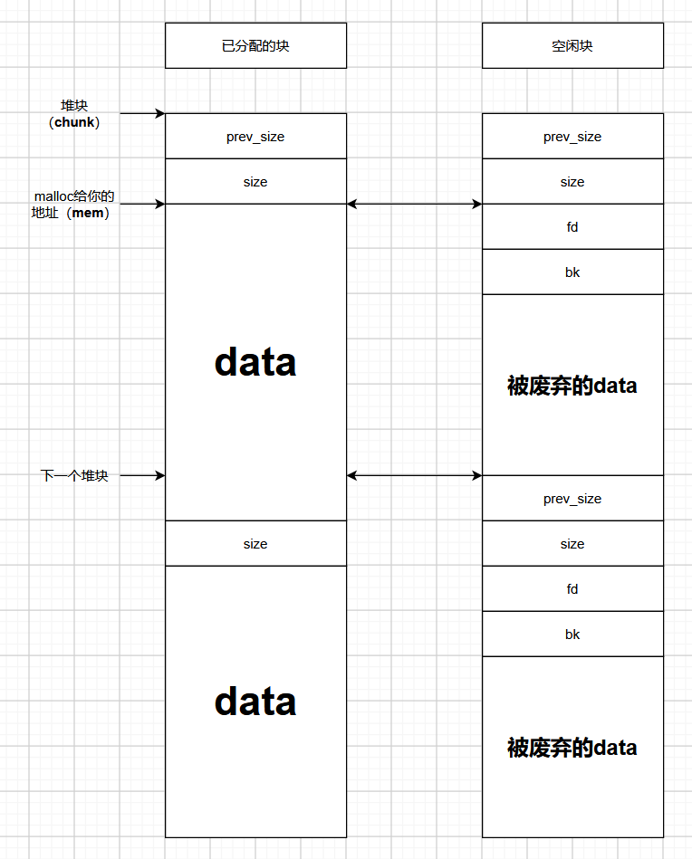
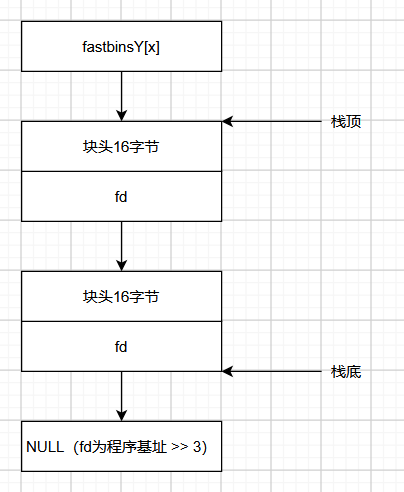
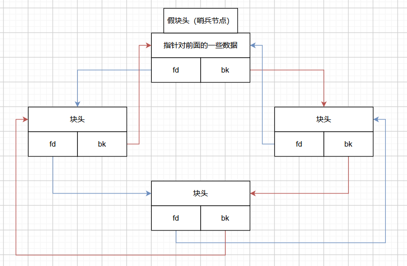

+++
date = '2026-10-01T08:00:00+08:00'
draft = false
title = 'ptmalloc2堆管理基础'
categories = ["Pwn", "Basic"]
series = ["PWN_basic"]
series_order = 8
summary = "究竟是什么样的邪恶组织能写出这种人神共愤的屎山代码？"
+++

水完前面的博客，按理来讲我应该再写点其他的栈攻击小东西，比如ret2dlresolve之类的，不过由于有些东西除了在我自己写的测试小题以外我几乎就没看到过几个相关的题，想了想还是算了吧，到时候再开一个系列把这些杂项扔进去。

所以现在就开始写点堆攻击。相比于栈攻击，堆攻击给人一种很模糊，难以搞清楚的感觉，通俗来讲这是因为对栈的操作是程序自己干的，看程序自己的反编译代码就能搞清楚程序干了什么；而对堆操作就不是程序干的了，只看反编译代码的话只能看懂程序想干什么，但是看不懂具体怎么做。这是因为堆内存由程序员手动控制内存的生命周期，而堆的特点是动态分配内存，可以申请未知大小的内存，完全交给程序员控制的话很麻烦而且不安全，需要一份工具辅助程序员操纵堆内存，这就是让你看不懂程序具体怎么做的**堆管理器**，如果非要看懂，那就得去研究堆管理器了。不同的环境下使用的堆管理器是不同的，这篇文章将简单介绍glibc自带，在linux中最常用的堆管理器：ptmalloc2。

ptmalloc2介于程序和内核中间，主要负责响应用户的内存存取需求。在前面我们提到，堆区一开始不分配内存，当开始申请堆内存时才会分配内存，由堆管理器控制，分块提供给用户，不够的话再额外分配内存。而当我们使用完这块内存后释放的时候，ta一般也不会直接归还物理内存，而是交给堆管理器，这样下次取用就不用现去分配内存了。可以看出堆管理器极大程度的方便了我们操纵堆内存，但是这种便利也带来了一些安全隐患，这恰恰给我们创造了实现堆攻击的机会。

所以接下来会简单扒一下ptmalloc2，其实现的堆内部结构相当复杂，相当乱套，相当版本迭代相当狗屎。为了尽量讲清楚，将其内部分为三大结构：**堆块（Chunk）、堆箱（Bin）和堆域（Arena）**。一句话概括他们三个的关系就是：**堆域管堆箱，堆箱装堆块**。下面开始一个个解释。

## 堆块 chunk

### 堆块结构

上面提到，拿到的堆内存会分块提供给用户，这就是堆块，该用的时候正常用，用完释放便会**变为空闲状态，进入堆箱**，再需要的时候便会视情况从堆箱中取出来处理一下。

堆块由glibc中一个叫`malloc_chunk`的结构体描述，源码如下：

```c
/*** 一些和定义相关的宏 ***/

	/* 一个内部专用的表示size的变量类型。 */
# ifndef INTERNAL_SIZE_T
# define INTERNAL_SIZE_T size_t
# endif

	/* INTERNAL_SIZE_T类变量的大小。 */
# define SIZE_SZ (sizeof (INTERNAL_SIZE_T))

	/* 位掩码。 */
# define MALLOC_ALIGN_MASK (MALLOC_ALIGNMENT - 1)

	/* 堆块的最小对齐要求，以前是这么算的（64位为8，32位为8或4），glibc2.26以后直接硬编码为16。 */
# define MALLOC_ALIGNMENT (2 * SIZE_SZ < __alignof__ (long double) \
              ? __alignof__ (long double) : 2 * SIZE_SZ)


/*** 结构体定义 ***/

// malloc / malloc.c

struct malloc_chunk
{
/*** 内存大小相关 ***/

	INTERNAL_SIZE_T mchunk_prev_size; /* 相邻的上一个块的大小，仅当上一个块空闲时有效。 */
	INTERNAL_SIZE_T mchunk_size; /* 该块的大小，包括块头。 */


/*** 堆箱链表相关（从这里开始就是数据区） ***/

	/* 用于堆箱的双向链表，仅当该块空闲时有效。 */
	struct malloc_chunk* fd; 
	struct malloc_chunk* bk;
	
	/* 用于largebin的额外双向链表，指向下一个更大的内存块的指针，仅当该块空闲时有效。 */
	struct malloc_chunk* fd_nextsize;
	struct malloc_chunk* bk_nextsize;

/*** 后面也是数据区 ***/
};
```

堆块的前面会有一些记载相关信息的变量，然后才是写入数据的区域。我们将前面这些称作**堆块头**，依次介绍一下块头里的几个变量：

- `prev_size`顾名思义就是相邻的上一个块的大小，也就是两个块指针的差值，只有当上一个块空闲时才有效。
- `size`就是自己的大小，这个大小要求**必须为上面提到的`MALLOC_ALIGNMENT`的整数倍**，如果申请的大小不满足，会向上取满足条件的最小值。这就导致了一般情况下size的低三位永远为0，因此被占用为标志位，记载了如下信息：
  - 最低位为`PREV_INUSE`，记载相邻的上一个块是否处于空闲状态，非空闲为1，空闲为0。
  - 次低位为`IS_MMAPPED`，记载该块是否是由`MMAP`分配的内存，是为1，不是为0。
  - 次次低位为`NON_MAIN_ARENA`，记载该块是否附属于主线程的堆，否为1，是为0。
- `fd`和`bk`是两个指针，用于表示在堆箱中的前后关系，fd指向堆箱中前一个（下一个）堆块，bk指向后一个（上一个）。堆块只有当该块空闲时才有效，后面会讲到。
- `fd_nextsize`和`bk_nextsize`也是表示堆箱前后关系的指针，不过只用于largebin这一特定堆箱。只有当该块空闲时才有效，后面会讲到。

值得注意的是，虽然一个块头的大部分区域只有在部分特定情况下有效，但是所有堆块都用这一种块头。只不过为了节约内存空间，块头一般不是完整呈现出来的，那些无效的区域会被当作正常的数据区，可以读写数据。**当一个块正在被使用时，两对链表指针会当作堆块自己的数据区**；**当其相邻的上一个块正在被使用时，`mchunk_prev_size`则会当作上一个块的数据区**；而**当该块空闲但不属于largebin时，其`nextsize`指针则会直接废弃**。如此，一个块头只有16字节（`prev_size` `size`）必要，而数据区要求至少16字节（`fd` `bk`）。可以申请到**最小的堆块为32字节**。

我们用`malloc`或者其他函数申请内存时，堆管理器便会返回一个指向这个块的指针，该指针实际上指向**堆块数据区的开头**，也就是指向`fd`指针的位置。这说明当我们释放一个块后，什么都不做直接访问该指针就能读取到`fd`和`bk`的值，这就为一些攻击手段提供了条件。

**下面是一图流总结：**



### 空闲堆块的常规合并

我们上面提到释放堆块不会立刻归还，而是留着以备下一次申请。这里有一个bug，如果我们申请的块比上一次小，理论上堆管理器可以不额外分配内存，把大的块再分成小块就可以了；但是如果我们每次申请的块都比上一次大，堆管理器该如何应对呢？这里就涉及到了一个重要的机制：**相邻的空闲堆块可以合并成一个大块**。

具体怎么合并呢？简单来讲是**先低后高**：当一个块被释放后，会先看低处的块是否空闲（通过看自己的`prev_inuse`），如果空闲就会合并；接下来看高处是否空闲（通过看高处块的更高处的`prev_inuse`），如果空闲也合并。合并后的块起始位置就是最低块的起始位置。

这种合并也存在一些特例，下面会讲到。

### 堆顶块 top chunk

接下来介绍两种特殊的堆块。

堆顶块是一种特殊的空闲块，其特点是**始终处于堆的最高处**。程序第一次调用`malloc`时，拿到的内存会分为两块，一块分给用户，另一块就是堆顶块。后续再次调用时，会先看空闲的块，如果无法满足需求，则会尝试从堆顶块低处分割出一块内存返回（如果也不满足就会扩容堆），高处成为新的堆顶块。

这里就提到了第一种堆块合并的特殊情况：
- **堆顶块的`prev_inuse`始终为1**，不会主动找低处的块合并。
- 不过如果这个低处的块被释放，检查高处空闲时发现高处是顶块的话，他们俩也会合并。
- ~注意这两点并不矛盾~

### 最后剩余块 last remainder

last remainder也是一种特殊的空闲块。上面提到申请的堆块可以从更大的堆块中分割出来，一般都是找最小的满足要求的块，分割出一块内存返回，剩下的就是最后剩余块。

## 堆域 arena

堆域是用于管理堆的结构，里面会记载这个堆的相关信息。ptmalloc2的一大特点就是支持多线程，其实现方式为维护多个堆，每个堆都有一个单独的堆域。一般来讲一个堆是只由一个线程占有，对应的堆域会直接塞进堆里。但如果线程多到cpu不能兼顾的话，为每个线程分配一个堆就不值当了，这时候会出现多个线程共用一个堆的情况。

属于主线程的堆的堆域比较特别，其被称为主堆域`main_arena`，**存储在libc的数据段**。

堆域由glibc中一个叫`malloc_state`的结构体描述：

```c
// malloc / malloc.c

struct malloc_state
{
/*** 同步锁和标志位 ***/

	/* 为了应对多个线程竞争同一堆域的同步锁。 */
	__libc_lock_define (,mutex);
	
	/* 用于记载堆域特性（比如是否启用了fastbins，是否为主堆域，是否为mmap分配的堆）的标志位 */
	int flags;

/*** 堆箱 ***/

	/* fastbins，用于快速存取小尺寸内存块的链表数组（数据结构为栈）。 */
	mfastbinptr fastbinsY[NFASTBINS];
	
	/* 堆顶块（top chunk）的基址，顶块不存放于任何箱中 */
	mchunkptr top;
	
	/* 最近一次拆分小请求时剩余的碎片块（last remainder chunk） */
	mchunkptr last_remainder;
	
	/* 常规堆箱，用于组织空闲内存块的链表数组（数据结构为双向循环队列）。 */
	mchunkptr bins[NBINS * 2 - 2];
	
	/* 堆箱位图，用于快速查找非空的堆箱。 */
	unsigned int binmap[BINMAPSIZE];

/*** 堆域链表与空闲堆域链表 ***/

	/* 指向下一个堆域的链表指针（数据结构为栈，但主堆域永远是链表头） */
	struct malloc_state *next;
	
	/* 指向下一个空闲堆域的链表指针，如果需要为新线程准备堆域，优先从此处取用。 */
    /* 此字段的访问由arena.c中的free_list_lock串行化。 */
	struct malloc_state *next_free;
	
	/* 附属于该堆域的线程数量，若值为0则为空闲堆域。 */
    /* 此字段的访问由arena.c中的free_list_lock串行化。 */
	INTERNAL_SIZE_T attached_threads;

/*** 内存大小 ***/

	/* 这个堆从系统中分配的内存量。 */
	INTERNAL_SIZE_T SyStem_mem;
	
	/* 这个堆允许从系统中分配的最大内存量。 */
	INTERNAL_SIZE_T MaX_SyStem_MeM;
};
```

简单介绍一下：

- `__libc_lock_define (,mutex);`是应对多个进程共享一个堆的情况，当其中一个进程控制了堆，其他进程必须等待该线程分配完成后才能访问。
- `flags`记载了堆域的一些信息。比如是否存在fastbin的堆块、是否为连续虚拟内存、内存是否损坏等。
- `fastbinsY`和`bins`就是堆箱，本质为由**多个链表构成的数组**。其中fastbin过于特殊，单独用一个特殊的数组；而unsortedbin smallbin largebin共用一个数组。在后面会讲到。
- `top`和`last_remainder`即指向堆顶块和最后剩余块的指针。
- `binmap`是堆箱位图，用于记载每个堆箱是否为空，每一个bit都会指示一个特定的链表是否存在空闲堆块。
- `next`和`next_free`用于将所有堆域按空闲和不空闲区分，分别串在两个不同的链表中。判断一个堆是否空闲的依据便是看该堆被几个线程占有，也就是`attached_threads`。这两个链表的结构和后面堆箱的结构类似，在后面会讲到。
- `SyStem_mem`记载这个堆目前分配的内存，`MaX_SyStem_mem`记载了其最大可以分配的内存。

> [!TIP]
> 堆域里的东西比较杂，我感觉初学的话只需要简单看看堆箱相关的部分就够了吧...

## 堆箱 bins

堆箱就是用来存储空闲块的结构，本质上就是一堆链表组成的数组，在具体实现中会分为4种堆箱：**fastbin、unsortedbin、smallbin、largebin**。

### fastbin

> [!TIP]
> 悲报：在glibc2.43中，fastbin被正式移除，以下内容只对2.43之前的版本有效。

先从最特殊的讲起。快箱fastbin顾名思义就是为了应对一些比较快速、轻量化的内存存取响应，具体体现在如下三个方面：

1. **fastbin中的块不会被合并**。具体实现方式为本身的`prev_inuse`始终为1，并且释放时其高处块的`prev_inuse`不会被置零。这也是上面提到的空闲堆块合并的第二种特殊情况。

2. **fastbin只处理不大于`global_max_fast`的块**，相关定义如下：

```
/* 计算fastbin链表数组的长度 */
# define NFASTBINS (fastbin_index(request2size(MAX_FAST_SIZE)) + 1)

/* 一般情况下只处理最大为这个值的chunk */
# ifndef DEFAULT_MXFAST
# define DEFAULT_MXFAST (64 * SIZE_SZ / 4)
# endif

/* 理论上支持的最大fastchunk */
# define MAX_FAST_SIZE (80 * SIZE_SZ / 4)

/* 设置global_max_fast（一般设置为DEFAULT_MXFAST） */
# define set_max_fast(s)                                                        \
    global_max_fast =                                                           \
        (((s) == 0) ? SMALLBIN_WIDTH : ((s + SIZE_SZ) & ~MALLOC_ALIGN_MASK))
# define get_max_fast() global_max_fast
```

**在32位下一般只处理小于64字节的块，64位下一般只处理小于128字节的块。这里的大小包含块头。**

由于对齐要求，在fastbin的范围内的块的数据区大小只能为8，16，24......fastbin为每一个大小都专门搞了个链表，串成一个数组，并且**用这个大小去计算数组的索引**：

```
# define fastbin_index(sz)                                                      \
    ((((unsigned int) (sz)) >> (SIZE_SZ == 8 ? 4 : 3)) - 2)
```

先右移再减二，右移可以去掉标志位顺带除以16，减二相当于直接减去了块头和指针的32字节，使得最小索引为0，这样数据区大小为8，16，24...的块，对应链表索引就是0，1，2...

3. fastbin的链表存储在一个单独的数组中，这个链表是一种类似栈的数据结构，**后进先出**，这样分配内存时更容易分配到缓存中的内存，更快。其只使用指针对中的`fd`指针，指向下方的元素，如图所示：



**每个`fd`直接指向下一个块的块头**，这样就将块构成了一种单向链表节点。同时fastbin数组中存储的指针始终指向最顶处的块，也就构成了栈顶。

另外，由于C语言传参是形参的问题，需要**刻意避免直接传入数组中裸指针没法改写的情况**。实际操作时会进行一个包装操作：

```
# define fastbin(ar_ptr, idx) ((ar_ptr)->fastbinsY[ idx ])
fbins = &fastbin(av, idx)
```

也就是说实际上传入的是这个指针的地址。

这种链表的存取操作如下：

```
/*** 存储 ***/

fwd = *fbins;
*fbins = victim;				// victim是插入的堆块
victim -> fd = fwd;

/*** 取出 ***/

victim = *fbins;				// victim是取出的堆块
*fbins = victim -> fd;
```

程序在申请或释放块时，如果涉及到fastbin，会先计算下标，在找到对应的fastbin指针，纪念性上面的存取操作

### `bins`概览

上面的fastbin虽然特殊，其实还是很易于理解的，但是下面的三种堆箱就比较绕弯子了...他们共同占用了堆域中的`bins`数组，而最绕的就是这个数组。因此在开始分析堆箱之前，先看看这个数组。

`bins`的长度被定义为`NBINS * 2 - 2`，其中NBINS宏如下：

```
# define NBINS 128
```

为什么要乘2？因为这三种堆箱是通过双向链表实现的，需要用到`fd`和`bk`指针。至于为什么要减2，这是因为smallbin的索引计算方式类似fastbin，也是位移，得到的最小索引也为2，其中索引1留给unsortedbin，索引0被舍去了，因此需要减2（其实是`(NBINS - 1) * 2`）。这样bins中就留下了127对指针，其中第`i`对指针在bins的索引为`(i - 1) * 2`和`(i - 1) * 2 + 1`。unsortedbin占据第1对，smallbin占据第2-63对，largebin占据第64-127对。

三个数组计算索引的方式都不同，在后面会讲到，我们先看看计算索引之后，为了避免裸指针他们是怎么包装的：

```
# define bin_at(m, i)	\
	(mbinptr) (((char *) &((m)->bins[((i) - 1) * 2])) - offsetof (struct malloc_chunk, fd))
```

这可太怪了，为什么找到对应的指针地址，还要减一个偏移？不过仔细看的话，发现这个偏移是`fd`相对于堆块起始的位移，这说明指针的地址相对于减掉这个偏移之后得到的地址的偏移也是一样的，这似乎有点明了了：减偏移的目的是为了将指针与其前面的数据包装成一个假的**堆块头**。

我们前面提到`bins`中的链表是双向链表，这个双向链表实际上是一种类似**循环队列**的数据结构，队首队尾中间加了一个**哨兵节点**，其实就是这个堆块头。这样包装之后，直接将得到的地址强转为`malloc_chunk`类型，访问`fd` `bk`指针，就能访问到需要的指针对，这实际上保证了链表中所有对象的类型相同。具体如图所示：



### unsortedbin

了解了`bins`，接下来就可以具体分析这三种堆箱了。先从unsortedbin开始，因为顾名思义，这个堆箱内部**不需要排序**，比较简单。

unsorted是用于临时存储一些刚刚释放的杂乱堆块，如果释放后其不进入fastbin，那么就会先进入这里，之后再判断存储到smallbin还是largebin。


### smallbin

### largebin


### 堆整理`malloc_consolidate()` fast块合并的特殊情况

## 特殊的空闲堆块管理器 tcache

## 完整的申请释放流程

## 堆相关的系统调用

### brk

### mmap


<!--
----------废料----------


它实际上会返回这个指针低处的一个地址，指针相对于这个地址的偏移正好等于堆块中`fd`的偏移，这样就相当于将指针和前面的一小段数据包装成了一个假的堆块头，作为一个同类型的哨兵节点。将该地址强转为块头类型的指针，访问其`fd`成员，就相当于访问这个指针。

## 宏观操作

首先简单了解一下，ptmalloc2提供的封装函数主要就是大家最熟悉的C语言堆管理函数：`malloc`和`free`，`malloc`负责申请，`free`负责释放。

`malloc`带一个参数`n`，指定了内存块的大小，申请成功之后会返回一个指向该内存块的**指针**。当`n`为0时，**会申请一个系统允许的最小的内存块**；而当`n`为负数时，由于传入无符号数，会转换为一个极大的正数，一般会分配失败。除了`malloc`以外，glibc也提供了`calloc`（将分配的内存块初始化为0），`realloc`（分配一个新的内存块，将旧块的数据复制到新块并释放）。

`free`带一个参数`p`，是一个指向对应内存块的指针。当`p`为0时，**函数不会执行任何操作**；若`p`指向的内存块已经被释放过，可能会引发一些意想不到的效果，这就是后面攻击会利用到的重点之一。
-->